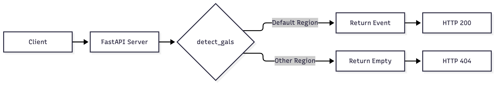
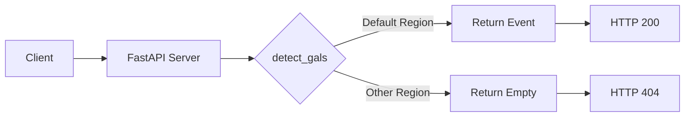

# SnailSight

Identify and locate GALS from visual data to enable targeted eradication.

# Galaxy Events MVP

A minimal FastAPI service detecting galaxy events.

## Usage

Run server:
uvicorn main:app --reload

Test:
pytest -q

## Architecture

Mermaid source

